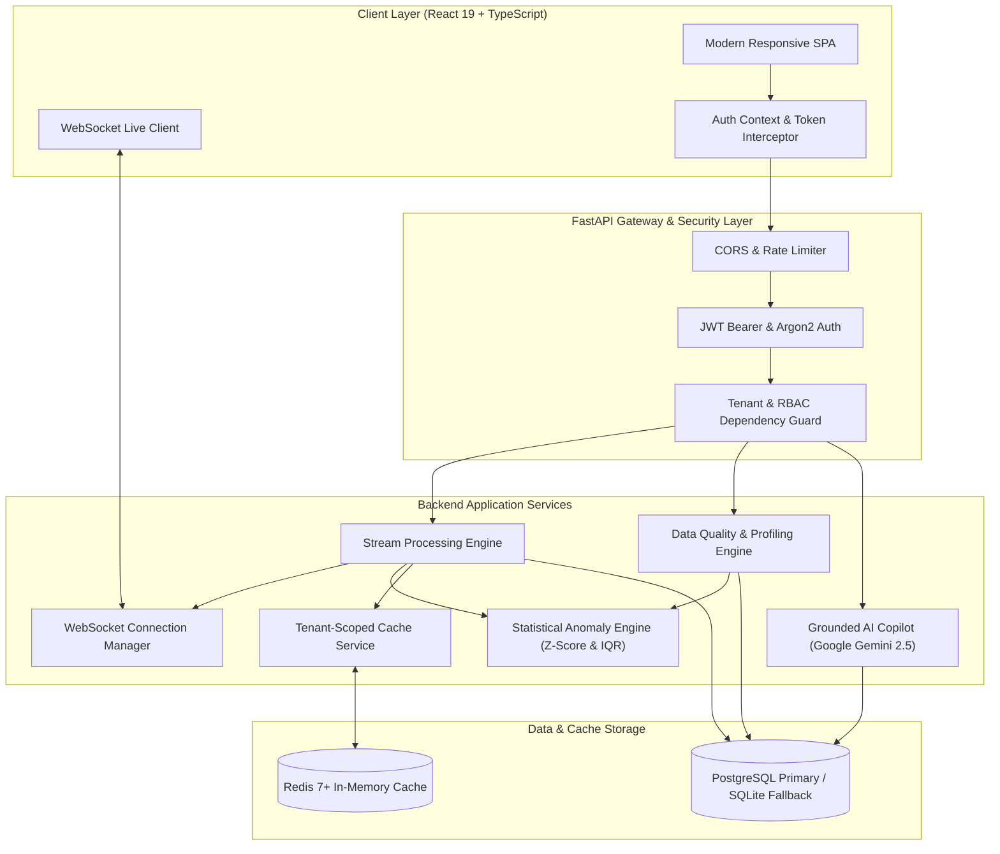
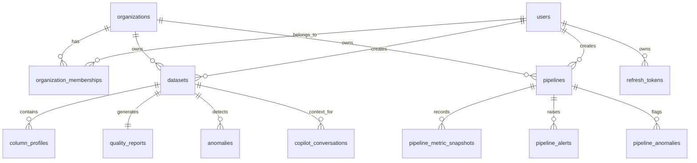

# DataPulse AI — System Architecture & Design Specification

DataPulse AI is an enterprise-grade Data Quality & Pipeline Observability Platform. This document outlines the core components, data flow pipelines, security architecture, and system integration patterns.

---

## 1. High-Level Architecture Overview

DataPulse AI follows a decoupled modern client-server architecture with an asynchronous event-driven streaming core and multi-tenant isolation:

---

## 2. Core Functional Subsystems

### 2.1 Ingestion & Data Profiling Engine (`backend/app/services/profiler.py`)
- **Supported File Types**: CSV (`text/csv`), Excel (`.xlsx`, `.xls` via OpenPyXL).
- **Safe Parsing**: Path sanitization, null byte elimination, byte stream size validation (up to 50 MB configurable).
- **Statistical Profiling**: Calculates column data types, null percentages, distinct value cardinalities, numerical distribution moments (min, max, mean, standard deviation, quartiles), and frequency distributions.

### 2.2 Multi-Dimensional Quality Analysis Engine (`backend/app/services/quality_engine.py`)
Quality health is computed across four weighted dimensions:
1. **Completeness (30% weight)**: Penalizes missing or null values in mandatory fields.
2. **Uniqueness (25% weight)**: Evaluates row duplication and primary key integrity.
3. **Validity (25% weight)**: Enforces regex syntax, type consistency, and format rules.
4. **Consistency (20% weight)**: Cross-column structural uniformity and schema adherence.

Score formula:
$$\text{Quality Score} = 0.30 \times \text{Completeness} + 0.25 \times \text{Uniqueness} + 0.25 \times \text{Validity} + 0.20 \times \text{Consistency}$$

### 2.3 Statistical Anomaly Engine (`backend/app/services/anomaly_engine.py`)
Identifies irregular records using two complementary statistical methodologies:
- **Modified Z-Score Outlier Filter**: Evaluates extreme standard deviations for normally distributed numeric dimensions ($|z| > 3.0\sigma$).
- **Tukey Interquartile Range (IQR) Filter**: Detects skewed outliers beyond the fence $[Q_1 - 1.5 \times \text{IQR},\, Q_3 + 1.5 \times \text{IQR}]$.
- **Null Spike Detector**: Flags unexpected null-rate jumps exceeding baseline thresholds.

### 2.4 Real-Time Streaming & WebSocket Observability (`backend/app/services/stream_processor.py`)
- Ingests structured JSON events individually or in batches (up to 500 records per tick).
- Validates records against registered JSON Schema definitions.
- Evaluates live records for schema drift, type mismatches, and numerical anomalies.
- Broadcasts real-time telemetry updates and alerts across tenant-isolated WebSocket channels.

### 2.5 Grounded AI Copilot (`backend/app/services/copilot_context.py` & `gemini_service.py`)
- Connects directly to Google's official Gemini API (`gemini-2.5-flash`).
- **Privacy-Safe Non-PII Context Sanitization**: Compiles high-level statistical summaries and schema metadata without sending raw user records to the LLM.
- **Deterministic Grounded Fallback Engine**: If no API key is provided or Gemini is unreachable, an internal deterministic rule engine analyzes data quality deductions and returns precise, actionable remediation steps without hallucination.

### 2.6 Multi-Tenant In-Memory Caching (`backend/app/services/cache_service.py`)
- Powered by `redis-py` (v8.1.0) with `fakeredis` test harness.
- Strict organization namespacing: `datapulse:{org_id}:{resource_type}:{...}` prevents cross-tenant data bleed.
- **Circuit Breaker**: Automatically bypasses cache if Redis fails, preventing connection timeout latency penalties.
- **Non-blocking Invalidation**: Cleans expired keys using batched `SCAN_ITER` patterns.
- **Anti-Cache Guards**: Blocks passwords, tokens, and secret credentials from being stored in Redis.

---

## 3. Role-Based Access Control (RBAC) Matrix

| Permission | Admin | Data Engineer | Analyst | Viewer |
|---|:---:|:---:|:---:|:---:|
| `USER_MANAGE` | ✅ | ❌ | ❌ | ❌ |
| `ORG_MANAGE` | ✅ | ❌ | ❌ | ❌ |
| `DATASET_UPLOAD` | ✅ | ✅ | ❌ | ❌ |
| `DATASET_DELETE` | ✅ | ✅ | ❌ | ❌ |
| `DATASET_READ` | ✅ | ✅ | ✅ | ✅ |
| `PIPELINE_MANAGE` | ✅ | ✅ | ❌ | ❌ |
| `PIPELINE_INGEST` | ✅ | ✅ | ❌ | ❌ |
| `PIPELINE_READ` | ✅ | ✅ | ✅ | ✅ |
| `ALERT_ACKNOWLEDGE` | ✅ | ✅ | ✅ | ❌ |
| `ALERT_RESOLVE` | ✅ | ✅ | ❌ | ❌ |
| `COPILOT_QUERY` | ✅ | ✅ | ✅ | ✅ |

---

## 4. Database Schema Relationships

